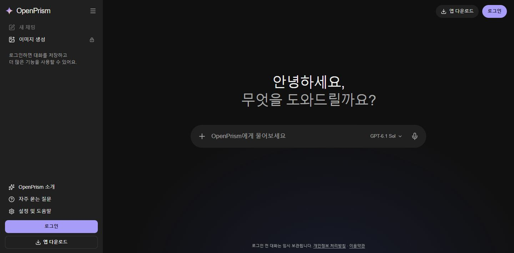
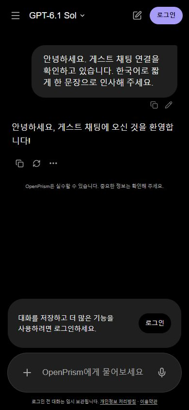

# Guest flow browser verification — 2026-11-05

Verified on the production custom domain, `https://getopenprism.com`, in the user's local Chrome.

## Observed results

- Signed-out desktop: separate guest screen; New Chat disabled when empty; Download app and Sign in visible; no PDF control.
- Real anonymous prompt: immediate user message, Stop while generating, actual OpenAI reply, then New Chat enabled. The conversation header retains Sign in and removes Download app.
- Stop: a second real request was interrupted after partial streaming; the interface retained the partial text, displayed the stopped state, and re-enabled New Chat.
- Mobile viewport: exactly 390 × 844; document width 390 with no horizontal overflow; composer font 17px and line-height 24px. The model picker is in the header, the sidebar is a drawer, and the composer is docked.
- Mobile New Chat: Cancel preserves the transcript; confirmation clears it and returns to the empty screen.
- Model and settings popovers: keyboard focus, Escape, and mobile bounds checked. Desktop tools/theme menus also checked in the managed local preview.
- Real authentication: ChatGPT's account chooser returned successfully to `/chat`, rendering the original workspace. No password or MFA challenge was exercised because an existing account session was available.
- Guest transcript save: explicit Save created an owner-scoped conversation which loaded in the existing workspace. The sign-in draft restored on arrival; a navigation fix additionally preserves it when opening the imported conversation.
- No browser console errors were reported during the successful guest and import checks.

Automated checks: 110 committed test cases passed across integration, provider features, workspace behavior, schedules, guest endpoint, and routing suites. TypeScript and the production build passed. Separate targeted storage checks covered restoration, interruption, expiry, and size bounds.

Screenshots contain only the public guest interface and synthetic test text. Account chooser screenshots are deliberately excluded.

