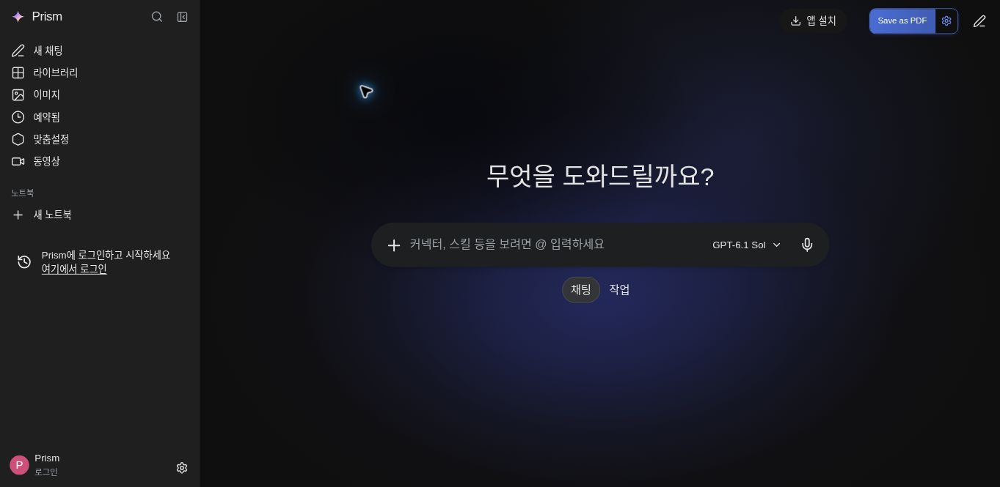
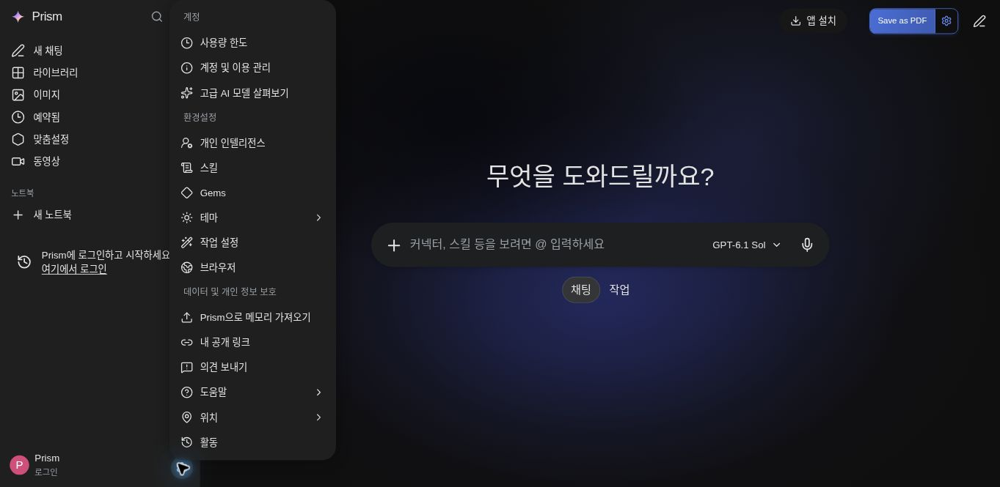

# Redesign verification — 4 November 2026

## Automated checks

- TypeScript: `node node_modules/typescript/bin/tsc --noEmit --pretty false` passed.
- API integration suite: 36/36 tests passed using an isolated SQLite database and mocked provider transports.
- New checks cover settings ownership and limits, fresh model context, disabled personalization, saved skills, literal title/body search, immutable public snapshots, attachment-body omission, revocation, the settings body budget, and concurrent public-link limits.
- `git diff --check` passed.

## Cloud-browser checks

| Check | Observed result |
| --- | --- |
| Desktop viewport | Real application rendered at 1440 × 703 CSS pixels in a responsive preview frame. |
| Sidebar and composer | Sidebar 288px; composer 660 × 64px, left edge x534, centered in the workspace. |
| Settings menu | x244, y0, 240 × 664px; background `rgb(31,31,31)`; entrance duration 0.12s. |
| Theme | Light changed the root theme and page surface; Dark restored the reference appearance. |
| Draft | Typing reveals Send while retaining the microphone; signed-out send returns the real authentication error. |
| Chat search | Opens with the search field focused and an accurate signed-out state; Escape closes it. |
| Menus | Model catalog, reasoning selection, upload/tools, Theme, and settings routes render. |
| Secondary route | Personalization opens `/personalization-settings`; anonymous users see sign-in rather than editable account data. |
| Unconnected media | Image action opens a clear unavailable state with working return/settings navigation. |
| Mobile viewport | 390 × 844; document width remains 390px with no horizontal overflow. |
| Mobile focus | Closed sidebar is hidden; opening traps focus and makes workspace inert. Closing an open menu with Escape leaves the drawer open. New chat closes the drawer. Resizing to desktop removes the inert state. |
| Console | No application-origin error or warning entries were observed in the inspected console log window. Browser-extension errors are unrelated to the application. |

The screenshots below show the 1440 × 703 layout scaled to the cloud browser's available width (1363 × 665 image pixels). The verification toolbar is cropped out. They show an anonymous development session, not a fabricated signed-in account.

## Verification limits

No live model request, microphone/location permission grant, new public share of user data, payment, or authentication flow was performed during visual QA. Authenticated backend behavior is covered by integration tests. Production model availability still depends on the existing runtime secrets, access, quota, and beta policy. This record does not claim pixel equality for proprietary fonts, unprovided mobile references, or unseen Gemini screens.
